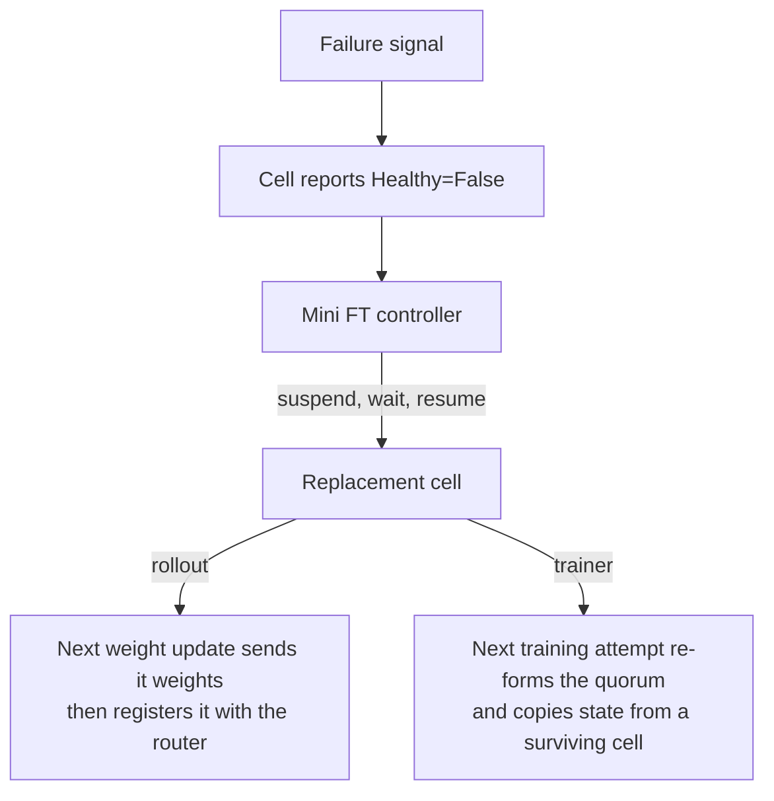

With `--use-fault-tolerance`, Miles keeps a run going when an SGLang engine or a Megatron data-parallel replica fails: it notices the failure, replaces the failed piece, and lets the replacement rejoin at the run's next synchronization point, without restarting the run. Each replaceable piece is a *cell*. One SGLang engine is one rollout cell; with trainer fault tolerance, one Megatron replica (all of its TP × PP × CP ranks) is one trainer cell.

## Choose what to protect

`--ft-components` selects the protected parts. Without it, `--use-fault-tolerance` selects `rollout weight_update`, and `train` must be added explicitly. Without `--use-fault-tolerance`, `--ft-components` is ignored.

| Component | Protects against | Requires |
|---|---|---|
| `rollout` | An SGLang engine that crashes, hangs, or never finishes starting. | `--update-weight-transfer-mode p2p` without `--colocate`; no dedicated eval pool (`--eval-num-gpus` stays 0); not `--fully-async` together with `--colocate`. |
| `weight_update` | An engine that fails while it receives new weights: the update completes on the other engines instead of failing the step. | Megatron, `--update-weight-transfer-mode p2p`, no `--colocate`. |
| `train` | A training replica whose process dies, raises, or stops answering. | Megatron; `--use-dynamic-batch-size`; one optimizer step per rollout (the global batch is the whole rollout batch); at least two replicas to survive losing one. Not with multi-LoRA, `--use-dynamic-global-batch-size`, `--calculate-per-token-loss`, or `--rematerialize-param-from-master-weight`. |

Select `weight_update` whenever you select `rollout`: a rollout cell can fail in the middle of a weight update, and without `weight_update` that failure fails the whole update.

## Enable it

Protect the engines (the default components):

```bash
--use-fault-tolerance \
--update-weight-transfer-mode p2p
```

P2P weight transfer has its own engine-side flags; see [P2P Weight Transfer](/advanced/p2p-weight-transfer).

Protect the trainer as well:

```bash
--use-fault-tolerance \
--ft-components rollout weight_update train \
--update-weight-transfer-mode p2p \
--use-dynamic-batch-size --max-tokens-per-gpu 8192
```

With `train`, each data-parallel replica runs as its own Megatron instance (`--indep-dp`, set for you), and the replicas combine gradients through a torchft process group instead of Megatron's own data parallelism. The number of trainer cells is the trainer GPU count divided by TP × PP × CP: 8 GPUs with `--tensor-model-parallel-size 2 --context-parallel-size 2` give two cells of four GPUs each. Expert parallelism stays inside a cell.

`train` also turns on `--delay-split-train-data-by-dp`, witness recording, and the event analyzer, and makes Megatron's non-persistent checkpoints node-local, under `/tmp/miles_local_ckpt` unless `--non-persistent-local-ckpt-dir` says otherwise. The startup log line that begins with `train in ft_components. Auto set` lists every setting it changed.

`--dumper-enable` turns fault tolerance off.

### Check that it is on

The process that runs `train.py` or `train_async.py` logs `Started mini FT controller on daemon thread` at startup, and serves the cell list on the same machine:

```bash
curl -s http://127.0.0.1:18080/api/v1/cells
```

The response is a `CellList` with one item for each cell of the enabled components; a trainer cell is named after its pool, such as `trainer-engine-actor-00000`. Each item carries `status.phase` (`Pending`, `Running`, or `Suspended`) and the conditions `Allocated`, `Healthy`, and, for rollout cells, `Serving`. `Healthy` reads `Unknown` while health checks are paused, which happens during offload, during weight updates, and in the grace period after each of them.

All flags and their defaults are in the [CLI reference](/user-guide/cli-reference#fault-tolerance).

## What happens when a cell fails



### Detection

| Signal | Cell | `Healthy` reason |
|---|---|---|
| `/health_generate` fails `--rollout-health-check-failure-threshold` checks in a row. | rollout | `HealthCheckFailed` |
| The engine is still not healthy 30 minutes after launch. | rollout | `StartupDeadlineExceeded` |
| A weight-update request to the engine fails or exceeds `--update-weight-engine-request-timeout`. | rollout, with `weight_update` | `CellErrored` |
| Any call into the cell raises; the cell is killed at once. | trainer | `ExecutionErrored` |
| The heartbeat RPC fails `--trainer-heartbeat-checker-failure-threshold` checks in a row. | trainer | `HealthCheckFailed` |

Rollout health checks run only while an engine waits for weights or serves, and they pause during offload and weight updates; each resume restarts the `--rollout-health-check-first-wait` grace period, so raise it when engines compile slowly (DeepGEMM, for example). The trainer heartbeat runs on its own RPC concurrency group, so it answers even while training waits in a collective: it proves the process is alive, not that training progresses. A replica stuck in the cross-replica gradient all-reduce surfaces through that collective's 120-second timeout instead.

### Recovery

1. The mini FT controller polls the cells every `--mini-ft-controller-poll-interval` seconds. For each unhealthy cell it suspends the cell, waits `--mini-ft-controller-resume-delay` seconds, and resumes it. On Ray this stops and restarts the cell's actors; on Kubernetes it deletes the cell's pods and lets their workload recreate them. A heal that fails is retried with exponential backoff, at most every five minutes.
2. The replacement comes up under a new identity. Miles drops the old cell, unregistering a rollout cell from the router first, and adds the new one.
3. A replacement rollout cell launches its engine and waits for weights. The next weight update waits for it, sends it the current weights over P2P, and only then registers it with the router.
4. A replacement trainer cell joins at the start of the next training attempt: the surviving cells and the replacement form a new quorum, and the first surviving cell sends its in-memory model and optimizer state to the replacement.

### What a failure costs

Generation requests go through the router and are retried up to 60 times, one second apart. Once the failed engine leaves the router, retries reach the remaining engines. In synchronous rollout, a group whose requests still fail is dropped, and the rollout draws new prompts to fill the batch. Rollout throughput is lower until the replacement serves. A weight update succeeds as long as at least one engine receives it.

A training step is decided by what the cells reported:

| Outcome of a training attempt | Decision |
|---|---|
| Every cell failed. | Retry if a cell is still alive; otherwise stop the run. |
| A cell's gradient all-reduce failed. | Discard the step and retry it on the surviving cells. |
| Some cells failed after the all-reduce and every survivor finished normally. | Keep the step: its gradients are complete. |

A step is retried at most 30 times. Each retry re-splits the rollout batch over the cells alive at that moment, which is why dynamic batch sizing is required. Checkpoint saves and HF exports run on the first alive cell and move to the next one if it fails.

## Drive the cells yourself

The mini FT controller is a client of a small Kubernetes-style HTTP API that the training process serves (`--api-server-host`, `--api-server-port`):

| Request | Effect |
|---|---|
| `GET /api/v1/health` | Reports that the API server is up. |
| `GET /api/v1/cells` | Lists the cells of the enabled components. |
| `GET /api/v1/cells/<name>` | Shows one cell. |
| `PATCH /api/v1/cells/<name>` with `{"spec": {"suspend": true}}` | Stops the cell. |
| `PATCH /api/v1/cells/<name>` with `{"spec": {"suspend": false}}` | Starts it again. Ray only: on Kubernetes the workload recreates deleted pods by itself. |

```bash
curl -s -X PATCH http://127.0.0.1:18080/api/v1/cells/trainer-engine-actor-00001 \
  -H 'Content-Type: application/json' -d '{"spec": {"suspend": true}}'
```

To heal cells from your own controller, pass `--no-mini-ft-controller-enable`, and `--api-server-host 0.0.0.0` when the controller runs on another machine. The API has no authentication, so anyone who can reach the port can stop cells; expose it only on a trusted network.

## Read the logs

Fault-tolerance events are logged in logfmt with the `ft` tag, such as `ft op=heal phase=suspend cell=...`:

| `op` | Logged by |
|---|---|
| `controller`, `heal` | The mini FT controller: each poll, and each suspend, wait, resume, or failed heal. |
| `health` | A cell's health checker: start, pause, resume, failed checks. |
| `state`, `execute`, `confirm_dead` | A trainer cell's state changes, calls into its workers, and kills. |
| `train`, `refresh`, `check` | The trainer controller: each attempt, each quorum change, and each step decision. |
| `create_pg`, `reconfig`, `cross_cell` | A trainer rank: the cross-replica process group and gradient all-reduce. |

## Limits

- Trainer cells cannot be healed before the first training step has finished.
- Losing every trainer cell, or every engine during one weight update, stops the run. Resume it from a persistent checkpoint with `--load`, as after any other crash.
- A deployment split with `--deploy-component` that does not run the orchestration script can protect only `train` and `weight_update`.
- CI covers single-node layouts only; multi-node fault tolerance is untested in CI.

## Test it

`--ci-fault-hooks` kills, freezes, or stops cells at named points of a run; see [Debugging](/developer/debug#the-assertion-harness-ci-uses). The end-to-end fault-tolerance suite in `tests/e2e/ft/` uses it, and `tests/e2e/ft/README.md` lists each scenario, the layouts it runs, and how to run it locally.
