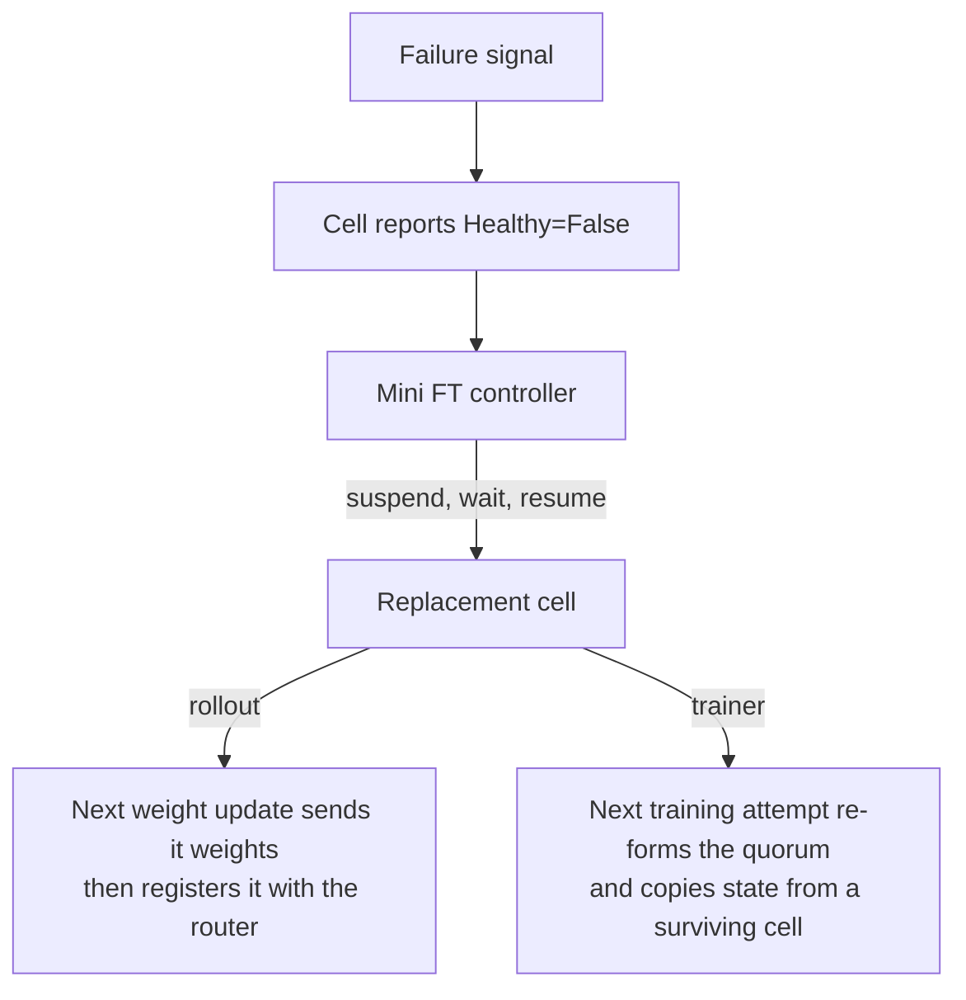

With `--use-fault-tolerance`, Miles keeps a run going when an SGLang engine or a Megatron data-parallel replica fails: it notices the failure, replaces the failed piece, and lets the replacement rejoin at the run's next synchronization point, without restarting the run. Each replaceable piece is a *cell*. One SGLang engine is one rollout cell; with trainer fault tolerance, one Megatron replica (all of its TP × PP × CP ranks) is one trainer cell.

## Choose what to protect

`--ft-components` defaults to `rollout` and `weight_update`; `train` is opt-in.

| Component | Protects against | Recovery | Requires |
|---|---|---|---|
| `rollout` | An SGLang engine that crashes, hangs, or never finishes starting. | Restart the engine; the next weight update loads it, then it rejoins the router. | No dedicated eval pool (`--eval-num-gpus` stays 0). |
| `weight_update` | An engine that fails while it receives new weights. | Finish the update on the other engines; restart the failed one as above. | Megatron. |
| `train` | A training replica whose process dies, raises, or stops answering. | Retry the step on the surviving replicas; the restarted replica rejoins with a copy of a survivor's model and optimizer state. | Megatron. Other constraints: the `indep_dp` and `enable_witness` checks in `miles/utils/arguments.py` and `miles/backends/megatron_utils/`. |

`rollout` and `weight_update` both need `--update-weight-transfer-mode p2p`, which updates each engine separately so one engine can fail without the others. P2P does not currently support `--colocate`, so colocated runs cannot use either.

## Enable it

Protect the engines (the default components):

```bash
--use-fault-tolerance \
--update-weight-transfer-mode p2p
```

P2P weight transfer has its own engine-side flags; see [P2P Weight Transfer](/advanced/p2p-weight-transfer).

Protect the trainer as well:

```bash
--use-fault-tolerance \
--ft-components rollout weight_update train \
--update-weight-transfer-mode p2p \
--use-dynamic-batch-size
```

With `train`, each data-parallel replica runs as its own Megatron instance (`--indep-dp`, set for you), and the replicas combine gradients through a torchft process group instead of Megatron's own data parallelism. The number of trainer cells is the trainer GPU count divided by TP × PP × CP.

All flags and their defaults are in the [CLI reference](/user-guide/cli-reference#fault-tolerance).

### Check that it is on

The process that runs `train.py` or `train_async.py` logs `Started mini FT controller on daemon thread` at startup, and serves the cell list on the same machine:

```bash
curl -s http://127.0.0.1:18080/api/v1/cells
```

A cell's `Healthy` condition reads `Unknown` while its health checks are paused, such as during offload and weight updates; that is not a failure.

## What happens when a cell fails



### Detection

| Signal | Cell | `Healthy` reason |
|---|---|---|
| `/health_generate` fails `--rollout-health-check-failure-threshold` checks in a row. | rollout | `HealthCheckFailed` |
| The engine is still not healthy 30 minutes after launch. | rollout | `StartupDeadlineExceeded` |
| A weight-update request to the engine fails or exceeds `--update-weight-engine-request-timeout`. | rollout, with `weight_update` | `CellErrored` |
| Any call into the cell raises; the cell is killed at once. | trainer | `ExecutionErrored` |
| The heartbeat RPC fails `--trainer-heartbeat-checker-failure-threshold` checks in a row. | trainer | `HealthCheckFailed` |

Rollout health checks pause while engines are offloaded or receive weights. When checks start on a new engine or resume after a pause, the first check waits `--rollout-health-check-first-wait` seconds, which is no wait by default. An engine still compiling kernels then, as with DeepGEMM, can fail that check and be restarted; raise the wait to cover compilation.

The trainer heartbeat shows only that the process is alive: it still answers while training is stuck. A stuck cross-replica gradient all-reduce fails after 120 seconds, and the step is retried.

### Recovery

The mini FT controller checks the cells every `--mini-ft-controller-poll-interval` seconds and restarts each unhealthy one: it suspends the cell, waits `--mini-ft-controller-resume-delay` seconds, and resumes it. On Kubernetes, suspending deletes the cell's pods and their workload recreates them. A failed restart is retried with backoff, at most five minutes apart.

### What a failure costs

Requests that the router sends to a failed engine before Miles removes it:

- On a crashed engine, they fail at once and are retried on other engines.
- On a hung engine, they wait until fault tolerance restarts it (about `--rollout-health-check-interval` plus `--rollout-health-check-timeout` plus one controller poll), then are retried on other engines. Without `rollout`, they wait for `--sglang-router-request-timeout-secs`.

In synchronous rollout, a group whose requests still fail is replaced with new prompts.

The next weight update waits, up to an hour, for every replacement engine to start, so training stalls for that startup time. An engine that hangs during a weight update holds it until `--update-weight-engine-request-timeout`, because health checks are paused then.

A training step that fails before its gradient all-reduce completes is discarded and retried on the surviving cells, at most 30 times; a failure after the all-reduce keeps the step. The survivors split the whole rollout batch among themselves, so each step is slower until the replacement rejoins.

## Drive the cells yourself

The mini FT controller drives cells through an HTTP API that the training process serves (`--api-server-host`, `--api-server-port`); you can use it too:

| Request | Effect |
|---|---|
| `GET /api/v1/cells`, `GET /api/v1/cells/<name>` | List the cells, or show one. |
| `PATCH /api/v1/cells/<name>` with `{"spec": {"suspend": true}}` | Stop the cell. |
| `PATCH /api/v1/cells/<name>` with `{"spec": {"suspend": false}}` | Start it again. Ray only: on Kubernetes the workload recreates the pods. |

```bash
curl -s -X PATCH http://127.0.0.1:18080/api/v1/cells/trainer-engine-actor-00001 \
  -H 'Content-Type: application/json' -d '{"spec": {"suspend": true}}'
```

To heal cells with your own controller, pass `--no-mini-ft-controller-enable`, plus `--api-server-host 0.0.0.0` if it runs on another machine. The API has no authentication; expose it only on a trusted network.

## Read the logs

Fault-tolerance events are logged in logfmt with the `ft` tag, such as `ft op=heal phase=suspend cell=...`:

| `op` | Events |
|---|---|
| `controller`, `heal` | Controller polls and cell restarts. |
| `health` | Health-check pauses, resumes, and failures. |
| `state`, `execute`, `confirm_dead` | Trainer-cell state changes, calls, and kills. |
| `train`, `refresh`, `check` | Training attempts, quorum changes, and step decisions. |
| `create_pg`, `reconfig`, `cross_cell` | The cross-replica process group and all-reduce. |

## Limits

- Trainer cells cannot be healed before the first training step finishes.
- Losing every trainer cell, or every engine in one weight update, stops the run; resume it with `--load`.
- A `--deploy-component` deployment that does not run the orchestration script can protect only `train` and `weight_update`.
- Multi-node fault tolerance is not tested in CI.

## Test it

`--ci-fault-hooks` kills, freezes, or stops cells at named points of a run; see [Debugging](/developer/debug#the-assertion-harness-ci-uses). `tests/e2e/ft/README.md` lists the end-to-end scenarios that use it and how to run them locally.
