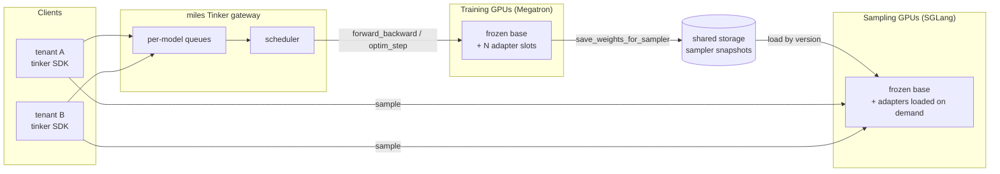

Multi-LoRA turns a miles deployment into a training service. Many clients each
fine-tune their own LoRA adapter on the same frozen base model, sharing one pool
of training and sampling GPUs. Clients talk to the service through the
[Tinker](https://thinkingmachines.ai/tinker/) API with the official `tinker` SDK,
so code written for Tinker, including the `tinker-cookbook` recipes, can point at
a miles gateway instead.

The client owns the training loop: data, sampling, rewards, and the schedule of
`forward_backward` and `optim_step` calls. miles owns the GPUs: it batches work
from all tenants onto the shared trainer, keeps each adapter's state isolated,
and serves every saved adapter version for sampling.

## When to use it

- **Many small experiments on one large model.** Run several RL or SFT jobs on
  one copy of the base weights, without a dedicated cluster per job.
- **Training as a service.** Expose training to users who write their loop
  against the Tinker API and never touch the cluster.
- **Bring your own harness.** Agentic RL with your own sandbox or agent
  framework: the client records exact sampled tokens and log-probs and trains on
  them directly.

To train one adapter with a dataset-driven miles recipe (a launch script, a
prompt dataset, and a reward model), use ordinary
[single-LoRA training](/advanced/lora) instead.

## How it works

1. **One model per client.** `create_model` assigns the client an adapter slot on
   the trainer. The trainer holds the frozen base once, plus a fixed number of
   slots (`--multi-lora-n-adapters`) at a maximum rank (`--lora-rank`). Each client
   picks its own rank up to that maximum. A distinct API key per tenant identifies
   who owns which models, futures, and checkpoints.
2. **Cross-tenant batching.** Each model has its own command queue. The scheduler
   picks the earliest ready request and packs datums from every model that runs
   the same operation and loss into one trainer forward pass, up to a token
   budget. Each datum is routed to its own adapter slot, so one pass serves
   several tenants. `optim_step` requests from different models step together
   in one trainer call.
3. **Isolated adapter state.** Gradients accumulate per adapter until that
   client calls `optim_step`, and each adapter has its own FP32 optimizer state.
   A failed `forward_backward`, `optim_step`, or `load_state` ends training for
   that model only; other tenants keep training.
4. **Versioned sampling.** `save_weights_for_sampler` writes an immutable adapter
   snapshot to shared storage. Sampling engines load the base once at startup and
   load adapter versions from disk when a request names them. The base is never
   re-synced, so engines may serve a quantized base while the trainer holds BF16.

Training and sampling use separate GPUs: each adapter's gradients stay on the
training GPUs between calls, so multi-LoRA does not support `--colocate`. The
[LoRA guide](/advanced/lora#multi-lora-training) documents the checkpoint and
restart semantics; the [gateway example](/examples/multi-lora#failure-handling)
documents failure handling.

## Supported models

Multi-LoRA runs on models with [Megatron-Bridge LoRA](/advanced/lora#lora-training-implementations)
support that SGLang can serve LoRA for, within the constraints below. Models with only
[native LoRA](/advanced/lora#native-lora) support train a single adapter today.

| Model | Launcher / CI |
|---|---|
| Qwen2.5-0.5B | |
| Qwen3-4B-Instruct-2507 | Gateway CI ([`tests/e2e/lora`](https://github.com/radixark/miles/tree/main/tests/e2e/lora)) |
| Qwen3-30B-A3B | [Gateway example](/examples/multi-lora), [agentic example](/examples/multi-lora/tinker-agent) |
| Qwen3.5-35B-A3B | |
| Qwen3.6-35B-A3B | [Harbor example](/examples/multi-lora/harbor-tinker) |
| DeepSeek-V2-Chat 236B | |
| MiMo-V2.6-Flash | [Launcher](/models/mimo/mimo-v2-6-flash#42-multi-lora-through-the-tinker-gateway) |
| GLM-5.2 | |
| Kimi K2.5 | |
| GLM-4.5-Air | |
| GPT-OSS-20B / 120B | |

In review:

| Model or layout | PR |
|---|---|
| Shared-outer expert adapters (validated on Qwen3.5-35B-A3B) | [#3899](https://github.com/radixark/miles/pull/3899) |
| Independent Q/K/V and gate/up projections (`canonical_lora`) | [#3905](https://github.com/radixark/miles/pull/3905) |
| Ungated MoE experts (Nemotron) | [#4032](https://github.com/radixark/miles/pull/4032) |

The trainer rejects a multi-LoRA launch that breaks any of these constraints:

- Separate training and sampling GPUs: no `--colocate` and no `--offload-train`,
  because each adapter's gradients stay in GPU buffers between calls.
- `--pipeline-model-parallel-size 1` and `--qkv-format thd`.
- Adam optimizer in BF16, without the distributed optimizer.
- For adapters on MoE experts: grouped-GEMM experts, expert tensor parallel size 1,
  BF16 experts (no FP8/FP4 training), and all of `gate_proj`, `up_proj` and
  `down_proj` targeted. The rollout engines may still serve a quantized base.
- SGLang without attention DP, and with one tokenizer worker.

## Tinker compatibility

The gateway implements the `tinker==0.26.2` wire schema; pin that SDK version on
the client. It supports:

- Training: `forward`, `forward_backward`, `optim_step`, `save_state`,
  `load_state`, and `save_weights_for_sampler`.
- Losses: `cross_entropy`, `importance_sampling`, `ppo`, `cispo`, and `dro`, with
  1-D per-token inputs. 2-D soft targets are not supported.
- LoRA targets: the `attn`, `mlp`, and `unembed` groups, matching the SDK's
  `train_attn`, `train_mlp`, and `train_unembed` flags. The server fixes the
  groups at launch; client flags must match them.
- Sampling: only from `save_weights_for_sampler()` paths, within one context
  window shared by training and inference (see
  [Context window](/examples/multi-lora#context-window)).

Futures, model leases, and request deduplication live in gateway memory and do
not survive a restart; saved checkpoints do.

## Get started

1. Launch the [Qwen3-30B-A3B gateway](/examples/multi-lora) on one 8-GPU node and
   run its single- and multi-tenant smoke checks.
2. Point a Tinker client or a `tinker-cookbook` recipe at the gateway URL, with
   `tinker==0.26.2`.
3. For agentic RL with your own sandbox or harness, use the
   [tinker_agent client](/examples/multi-lora/tinker-agent), or the
   [Harbor integration](/examples/multi-lora/harbor-tinker) for Harbor tasks.
