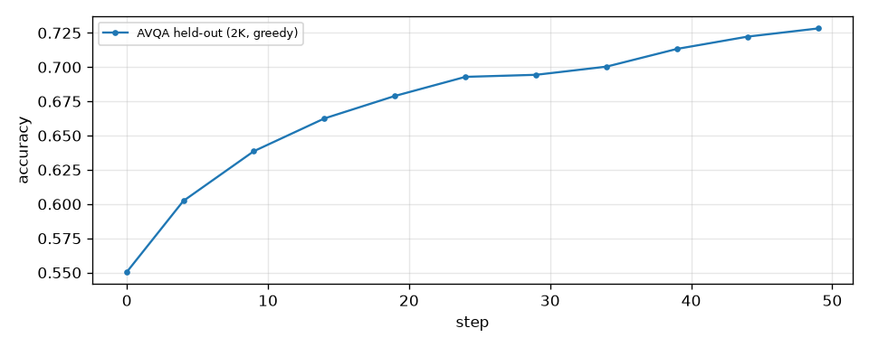
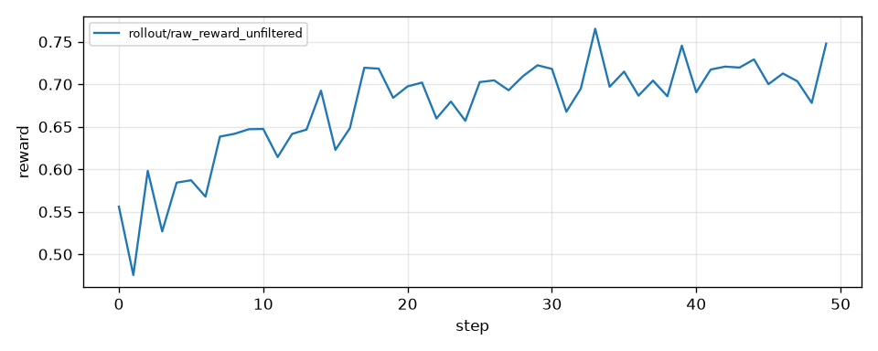

GRPO on audio questions: the model hears a clip, reads a four-option question and answers with a letter; the
reward is 1 when the letter is right. The recipe trains the LoRA of Inkling-Small on [AVQA](https://huggingface.co/datasets/Joysw909/AVQA)
and scores a held-out slice of AVQA every five steps.

The model is the plugin Inkling model with its frozen audio and vision towers
(`miles_plugins.models.inkling.model.inkling_mm_model_provider`). Clips travel as shared file paths: SGLang's
Inkling token-space strategy decodes each clip, turns it into dMel frames and expands the audio placeholder, and every
trainer rank rebuilds the same tensors from the files in the background (`--multimodal-token-space-processing`).

## Data

```bash
hf download --repo-type dataset Joysw909/AVQA --local-dir /root/datasets/avqa
python examples/avqa_audio/prepare_avqa_audio.py /root/datasets
```

`prepare_avqa_audio.py` writes every clip as 16 kHz mono WAV and two prompt files under `avqa_audio/`:
`train.jsonl` (29.6K AVQA questions) and `avqa_heldout.jsonl` (2K AVQA questions held out by clip, with a fixed seed
and the same share of every question type as the training data). The AVQA repack only carries the dataset's training
subset, so the held-out slice is the eval set.

## Run

```bash
python scripts/run_inkling.py train \
    --model-name Inkling-Small --train-mode lora --task avqa_audio \
    --num-gpus-per-node 8 --rollout-num-gpus-per-engine 8 \
    --model-dir /root/models --data-dir /root/datasets --save-dir /root/ckpt \
    --lr 2e-4 --num-rollout 50 --rollout-batch-size 64 --n-samples-per-prompt 8 --global-batch-size 128 \
    --rollout-max-response-len 1024 --sglang-context-length 4096 --enable-eval
```

One node of 8 H200 holds the frozen 276B weights (TP4 SP PP2 EP4) next to a LoRA of rank 32 on every linear layer;
the engines and the trainer share the GPUs and offload in turn. Each step samples 64 prompts x 8 answers, keeps
sampling until every group in the batch has both right and wrong answers, and trains four micro-steps of 128.
Evaluation is greedy with a 2048-token budget.

The `avqa_audio` task grades through `examples/avqa_audio/reward.py`: Inkling writes thinking blocks before the text
block that carries the letter, so the reward parses the response tokens with the Inkling response parser and hands
only the visible text to the GPQA letter grader. Grading the flat response instead reads letters out of the thinking
and scores a quarter of right answers as wrong.

## Results

Inkling-Small LoRA, 50 steps on 8 H200, scored every 5 steps with greedy decoding:

| step | 0 | 4 | 9 | 14 | 19 | 24 | 29 | 34 | 39 | 44 | 49 |
|---|---|---|---|---|---|---|---|---|---|---|---|
| AVQA held-out (2K) | 55.1 | 60.2 | 63.9 | 66.3 | 67.9 | 69.3 | 69.4 | 70.0 | 71.3 | 72.2 | 72.8 |

The held-out score rises 17.8 points and is still climbing at step 49. The training reward goes from 0.56 to
about 0.70.





## Notes

- The AVQA repack only has the training subset (the official validation set ships YouTube links, not audio), so the
  held-out slice is cut from it: whole clips, a fixed seed, and the same share of every question type.
- Greedy evaluation of the same checkpoint moves by up to 0.6 points between runs, so single-point differences below
  that are noise.
