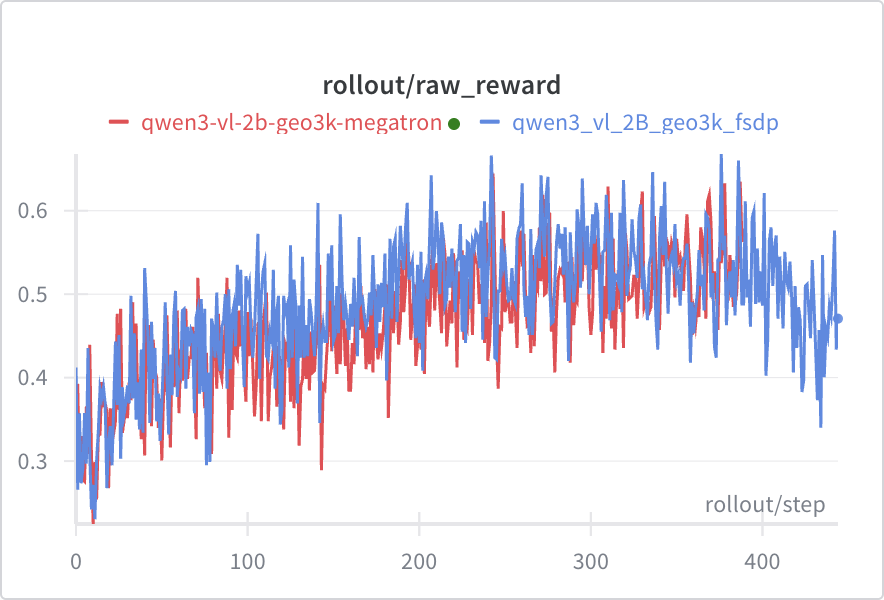

Training VLMs with FSDP or Megatron on single-turn reasoning task using GRPO on the [GEO3K dataset](https://huggingface.co/datasets/hiyouga/geometry3k). We used processed version [here](https://huggingface.co/datasets/chenhegu/geo3k_imgurl).

Use the CUDA 13 Miles image from the [installation guide](/getting-started/installation) and keep its bundled cuDNN version.



## Data Preparation (For SFT Training)

The [geo3k_imgurl](https://huggingface.co/datasets/chenhegu/geo3k_imgurl) dataset contains:
- `problem`: The math problem text (string)
- `answer`: The answer (string, e.g., "270")
- `images`: Image data (list)

For SFT training, we need to format the `answer` field for `\boxed{}` format and the messages. You can use the following script to format the answer field:

```python
from datasets import load_dataset
import pandas as pd

ds = load_dataset("chenhegu/geo3k_imgurl", split="train")

def format_answer(answer: str) -> str:
    """Format answer to include \\boxed{} format."""
    return f"Answer: \\boxed{{{answer}}}"

def process_sample(sample):
    formatted_answer = f"Answer: \\boxed{{{sample['answer']}}}"
    
    sample["messages"] = [
        {"role": "user", "content": sample["problem"]},
        {"role": "assistant", "content": formatted_answer}
    ]
    return sample

ds = ds.map(process_sample)
ds.to_parquet("/root/datasets/geo3k_imgurl/train_formatted.parquet")
```

## Reproduce

```bash
export WANDB_API_KEY=your_wandb_api_key

# Megatron backend (default -> Qwen3-VL-8B-Instruct + Megatron)
./examples/geo3k_vlm/run_geo3k_vlm.sh

# FSDP backend
MILES_SCRIPT_TRAIN_BACKEND=fsdp ./examples/geo3k_vlm/run_geo3k_vlm.sh

# With different model
MILES_SCRIPT_MODEL_NAME=Qwen3-VL-4B-Instruct ./examples/geo3k_vlm/run_geo3k_vlm.sh

# SFT
./examples/geo_3k_vlm/run_geo3k_vlm_sft.sh
```

### Configuration

| Environment Variable | Default | Description |
|---------------------|---------|-------------|
| `MILES_SCRIPT_TRAIN_BACKEND` | `megatron` | Training backend (`megatron` or `fsdp`) |
| `MILES_SCRIPT_MODEL_NAME` | `Qwen3-VL-8B-Instruct` | Model name |
| `MILES_SCRIPT_DATASET_NAME` | `chenhegu/geo3k_imgurl` | HuggingFace dataset name |
| `MILES_SCRIPT_NUM_GPUS` | `8` | Number of GPUs |
| `MILES_SCRIPT_EXTERNAL_RAY` | `0` | Use external Ray cluster (`1` to enable) |

### Supported Models

- `Qwen3-VL-2B-Instruct`
- `Qwen3-VL-4B-Instruct`
- `Qwen3-VL-8B-Instruct`
- `Qwen3-VL-30B-A3B-Instruct`
- `Qwen3-VL-235B-A22B-Instruct`
- `Qwen3-VL-2B-Thinking`
- `Qwen3-VL-4B-Thinking`
- `Qwen3-VL-8B-Thinking`
- `Qwen3-VL-30B-A3B-Thinking`
- `Qwen3-VL-235B-A22B-Thinking`

## Training with Token Space Processing

Models whose SGLang build has a token-space strategy can run on the token-space processor instead of the Miles-side
HF processor: SGLang expands one placeholder token per image and computes the vision features, and every trainer
rank rebuilds the same tensors from the files under `--shared-media-dir` (`--multimodal-token-space-processing` with
`--sglang-enable-token-space-processor`; Megatron backend only; on multi-node runs that directory must be a shared filesystem).
One processor on both sides (zero train/rollout diff), one shared custom preprocessing cache, token-in/token-out (TITO) engines.

```bash
# Qwen3.8-27B (the Qwen3.5-27B architecture) on the plugin Qwen3.5 text model with its frozen vision tower
python examples/geo3k_vlm/run_geo3k_qwen3_8_27b.py
```

The multi-turn recipe runs Qwen3.5-35B-A3B in token space, with a result: see [multi_turn](/examples/geo3k-vlm/multi-turn).

## Notes

### Reward Model Configuration

We experimented with three reward model configurations:
1. A geo3k-specific RM with tolerance=0.05 (to handle rounding in ground truth labels)
2. A geo3k-specific RM with tolerance=0.0 (strict matching)
3. The default math RM

All three performed similarly, so we use the default math RM for simplicity.

### Numerical Precision with Non-Binary Rewards

Our initial geo3k-specific verifier produced "format scores" (**0 and 0.9**) instead of clean binary rewards. Under **fp32**, fractional values like 0.9 can't be exactly represented, so when all samples in a group have the same reward, `reward - mean` doesn't equal zero—creating spurious gradient signal.

We fixed this by switching to the default math RM with clean **binary 0/1 rewards**. If you encounter similar precision issues with non-binary rewards, you can change the reward tensor dtype from `torch.float` to `torch.float16` in `miles/ray/rollout/train_data_conversion.py` (`_post_process_rewards`) to truncate precision artifacts.

## B200
Blackwell currently does not support fa3, we need to use  `--sglang-mm-attention-backend sdpa` and `--attn-implementation flash_attention_2`
