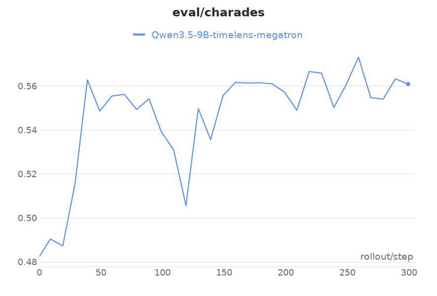
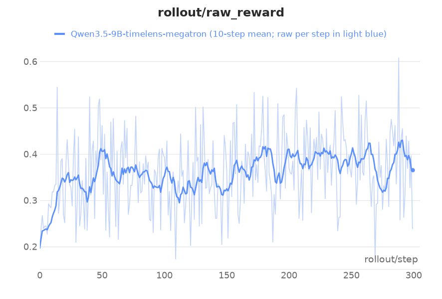
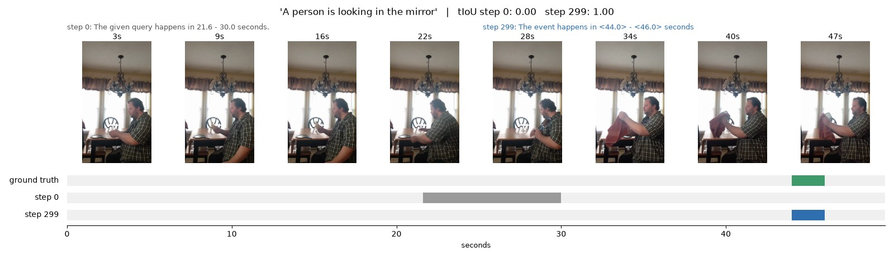
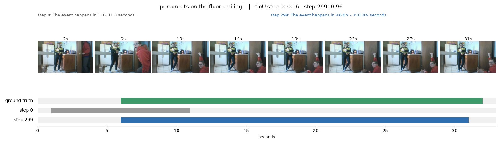
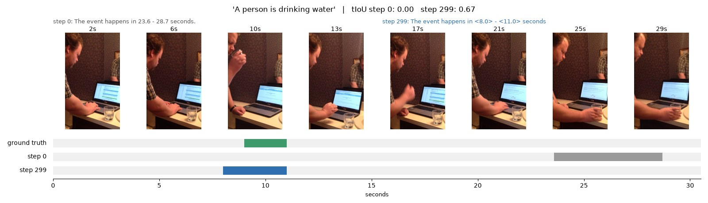

GRPO on [TimeLens](https://github.com/TencentARC/TimeLens) temporal grounding: given a video and a sentence, the model
answers the start and end time of the event, and the reward is the IoU of its first predicted span with the ground
truth. The recipe follows TimeLens GRPO (tIoU reward, no KL, no std normalization, constant lr 1e-6) on Qwen3.5-9B,
plus one training-reward step of ours (see Notes).

The model is the plugin Qwen3.5 text model with the frozen vision tower
(`miles_plugins.models.qwen3_5.qwen3_5_mm_model_provider`). Videos travel as shared file paths: SGLang samples the
frames and expands the placeholders in token space, and every trainer rank rebuilds the same tensors from the files
in the background (`--multimodal-token-space-processing`).

## Data

```bash
hf download --repo-type dataset TencentARC/TimeLens-Bench --local-dir /root/datasets/timelens/TimeLens-Bench
hf download --repo-type dataset JungleGym/TimeLens-Qwen3-VL-8B-filter-data --local-dir /root/datasets/timelens/filter-data
hf download --repo-type dataset TencentARC/TimeLens-100K --local-dir /root/datasets/timelens/TimeLens-100K
# unpack each dataset's video_shards/*.tar.gz into <dataset>/videos as the TimeLens README does, then:
python examples/timelens_video/prepare_data.py /root/datasets/timelens
```

`prepare_data.py` writes `timelens_grpo_train.parquet` (2.5K prompts, sampled by difficulty as TimeLens does) and
`timelens_bench_charades_600.parquet` (600 Charades items for eval). The parquets store absolute video paths.

## Run

```bash
python examples/timelens_video/run_timelens_qwen3_5.py
```

The launcher downloads Qwen3.5-9B, converts it to `torch_dist` (the multimodal model keeps the text model's
parameter names), and trains 300 steps of 16 prompts x 8 samples on 8 GPUs, evaluating Charades every 10 steps.

The trainer and the engines share the GPUs and offload in turn. The vision tower is frozen, and every weight sync
re-sends it from the checkpoint, so the engines get it back after each offload.

## Results

Qwen3.5-9B, 300 steps on 8 H200 (TP4), scored every 10 steps on 600 held-out Charades-STA items (none of the
training videos come from Charades): tIoU 0.48 at step 0, 0.56-0.57 from step 150 on, best 0.573. The train vs
rollout logprob gap stays around 0.006 for the whole run.





Three held-out Charades items, answered by the model at step 0 and at step 299. Each strip shows eight frames of the
video and, below them, the ground-truth span (green), the step-0 prediction (gray) and the step-299 prediction (blue).
Over the 600 items, 180 improve by more than 0.2 tIoU and 68 get worse by more than 0.2.







## Notes

- Responses cut at the 512-token limit score 0 in training (`zero_truncated_rewards`). This step is ours, not part
  of the TimeLens recipe: the tIoU reward reads only the first predicted span, so text after it is free, and without
  this step a run grew its answers to the 512-token limit for the second half of training. Eval keeps the TimeLens
  scoring.
- Videos decode on CPU (`video_preprocessing_device` in `--sglang-mm-process-config`), on the engines and the
  trainer alike: on the GPU, the engines' concurrent float32 frame resizes ran the colocated engines out of memory.
- 300 steps x 16 prompts is about two passes over the 2.5K prompts.
